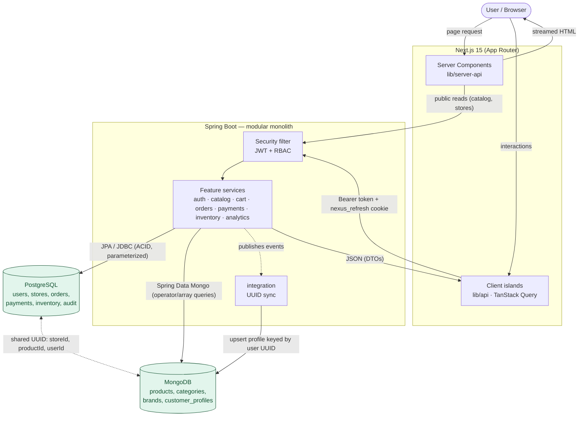

# Data-flow diagram

How a request moves through the system, and how the two databases stay coherent
through the shared UUID. Two data lanes: public catalog reads are server-rendered
(RSC) directly; authenticated reads/writes go through the browser client with a
Bearer token + refresh cookie.

## The UUID bridge (no cross-engine foreign keys)

| Relational side (PostgreSQL) | Shared UUID | Document side (MongoDB) |
|---|---|---|
| `stores.id` | `storeId` | `products.storeId` |
| `cart_items.product_id`, `order_items.product_id`, `inventory.product_id` | `productId` | `products._id` |
| `users.id` | `userId` | `customer_profiles._id` |

The `integration` module keeps the document side coherent: on registration it
upserts a `customer_profiles` doc (ADR-0011); from Phase 6, the customer also writes
back favorites and recently-viewed through the same UUID (ADR-0016).
