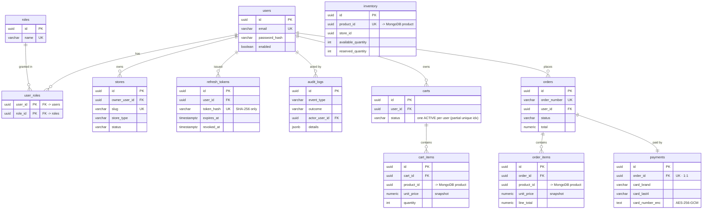

# PostgreSQL ERD (3NF relational model)

The transactional store (schema `commerce`). Normalized to 3NF: the user↔role
many-to-many is resolved by the `user_roles` junction table; catalog data on
`cart_items` / `order_items` is an intentional point-in-time **snapshot**, not a
normalization violation (a sale must keep the price/name as they were at purchase).

`product_id` / `store_id` columns are **UUID references into MongoDB** (the catalog)
— there is no database-level foreign key across engines; the shared UUID is the
bridge (ADR-0003).

> `inventory` has no relational FK — it is keyed by the MongoDB product UUID and
> linked to orders only through that shared id. `sp_reserve_inventory` locks its row
> `FOR UPDATE` during the ACID checkout.
