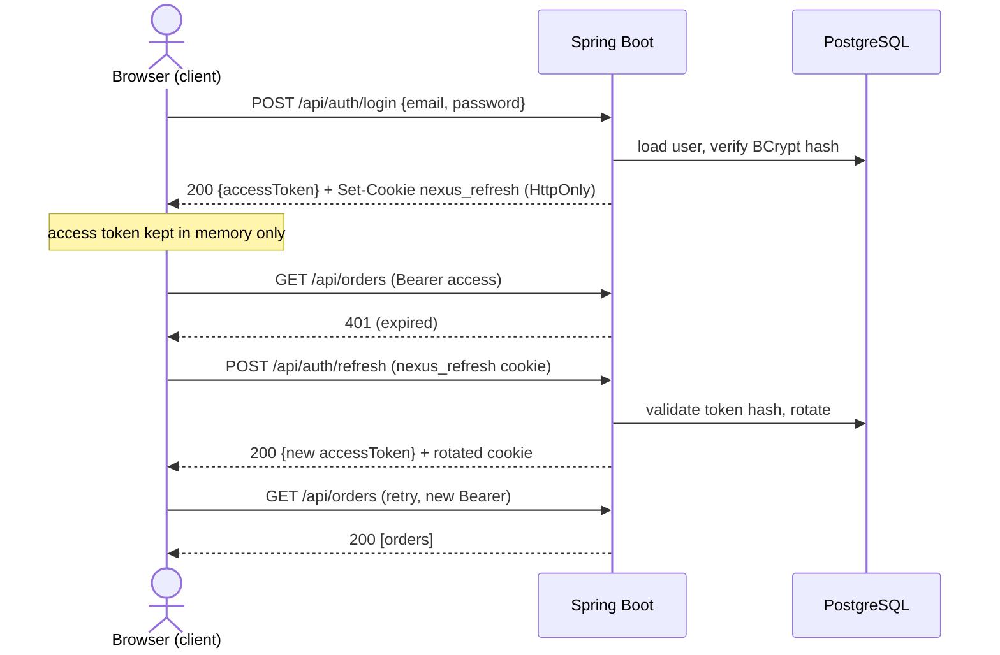
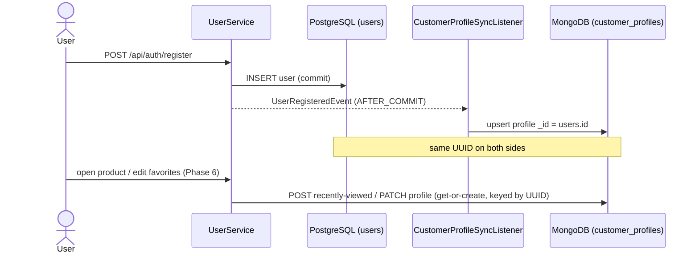

# Sequence diagrams

## 1. Login + silent refresh on 401

Access token lives in browser memory; the refresh token is an HttpOnly cookie. A
401 triggers exactly one coalesced refresh + retry (ADR-0008 / ADR-0015).



## 2. ACID checkout (single transaction)

Reserve stock → create order → encrypt payment → close cart, all-or-nothing
(ADR-0012 / ADR-0013).

```mermaid
sequenceDiagram
    actor U as Customer
    participant CO as CheckoutService
    participant INV as inventory (sp_reserve_inventory)
    participant PG as PostgreSQL
    participant AUD as audit_logs

    U->>CO: POST /api/checkout {shipping, card}
    activate CO
    Note over CO,PG: @Transactional — one unit of work
    loop each cart item
        CO->>INV: CALL sp_reserve_inventory(productId, qty)
        INV->>PG: SELECT ... FOR UPDATE; decrement / reserve
        alt insufficient stock
            INV-->>CO: RAISE (check_violation)
            CO->>AUD: CHECKOUT_FAILED (REQUIRES_NEW)
            CO-->>U: 400 — rolled back (no order, no charge)
        end
    end
    CO->>PG: INSERT order + order_items (price snapshot)
    CO->>PG: INSERT payment (card_number_enc = AES-256-GCM; CVV never stored)
    CO->>PG: UPDATE cart SET status = CHECKED_OUT
    CO->>AUD: ORDER_PLACED + PAYMENT_CAPTURED
    CO-->>U: 201 OrderResponse
    deactivate CO
```

## 3. Cross-database customer sync (the UUID bridge)

Registration seeds the Mongo profile after commit (ADR-0011); Phase 6 adds live
write-back keyed by the same UUID (ADR-0016).


